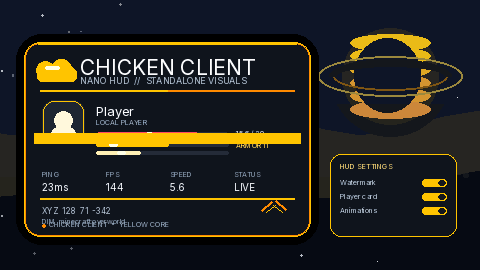

# Chicken Client



Animated design preview of the yellow NanoVG HUD and the in-game settings card.

Chicken Client is a Meteor Client addon for Minecraft 1.21.11.

## Included

- **Karambit** - animated first-person karambit replacement.
- **Fullbright** - client-side fullbright lightmap.
- **Freecam** - detached, no-clip camera; the player stays in place and can keep mining.
- **Free Look** - independent camera look with an optional through-walls mode.
- **Block ESP** - configurable block scanner with boxes and tracers.
- **Storage ESP** - container detection with block-entity debug and chunk data readouts.
- **Nano HUD** - a fully standalone NanoVG HUD with its own config, mixin, GL frame, font and native libraries. It does not depend on Meteor's HUD, settings, modules or 2D renderer. It has an animated cloud watermark, player card, health/armor/XP bars, ping/FPS/speed counters, coordinates and an editor overlay. F7 toggles it; F8 opens the Meteor-free in-game settings screen with a live yellow HUD preview, player state and instant color/toggle updates; hold right-shift, drag with the left mouse button and use `[`/`]` to scale. The main brand color is yellow. Config: `config/chicken-client/nano-hud.properties`.
- **Red Wings** - layered animated crimson wings for yourself and nearby players, with glow, feather ribs and ember trails.
- **Cosmic Sky** - a cinematic 3D atmosphere with ringed planets, aurora ribbons, twinkling stars and shooting stars, using the yellow Chicken Client palette by default.
- ClusterBypass, BaseFinder, PlayerFinder, SpawnerFlag, ClearRender and Storage ESP utilities.

## Build

```bash
./gradlew build
```

The jar is written to `build/libs/chicken-client-<version>.jar`.
